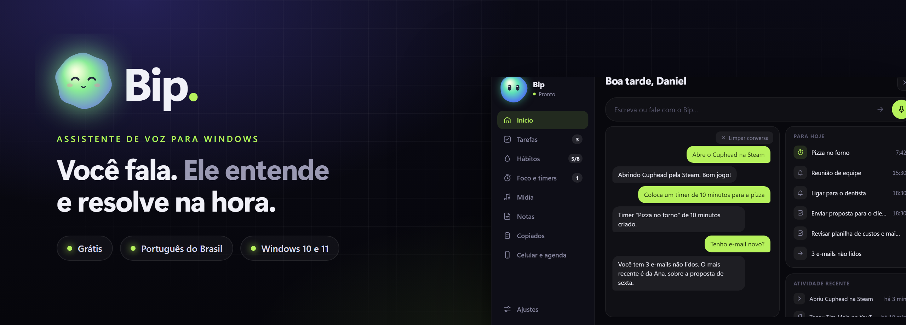
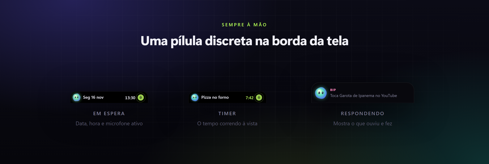
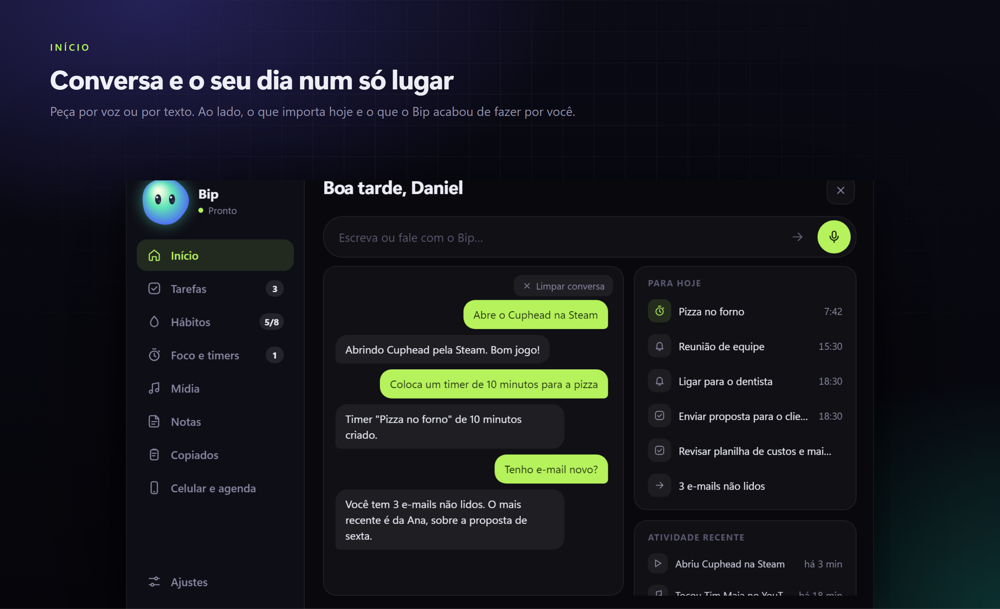
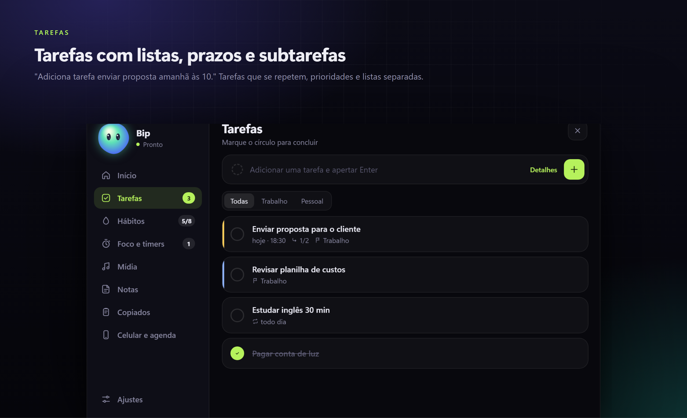
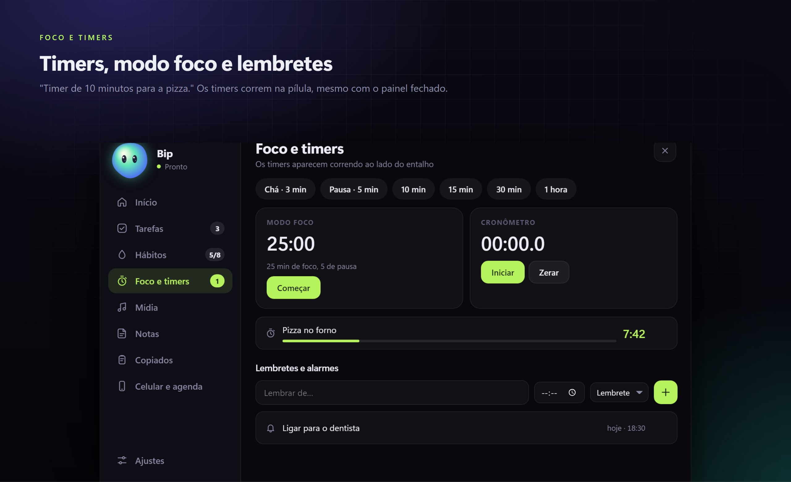
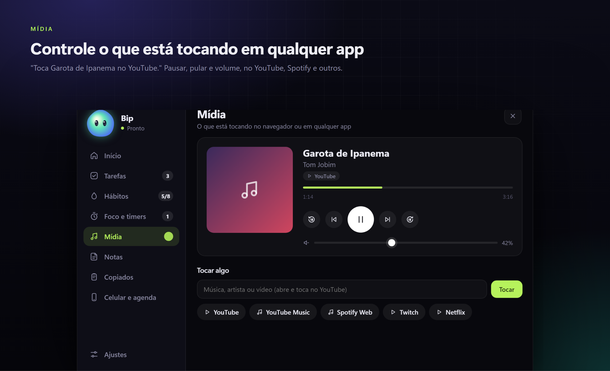
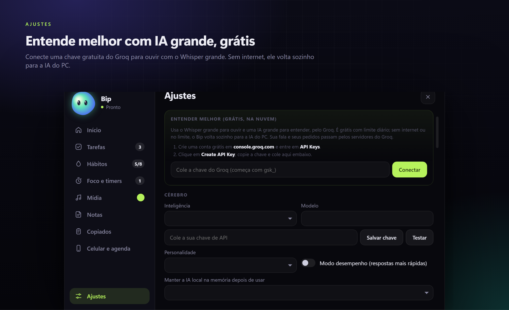

  

  
  
  
  

  <b>Diga “Bip” e peça. Ele entende, responde e faz.</b> 
  Abre programas e jogos, toca músicas, cuida dos seus timers, tarefas e e-mails, sem tirar você do que está fazendo.

  

---

## Visão geral

O Bip é um assistente de voz para Windows, em português do Brasil. Ele fica encostado na borda da tela como uma pílula pequena. Quando você chama, ele se abre, resolve o pedido e volta a ficar discreto.

## Recursos

| | Recurso | Exemplos do que dizer |
|:-:|---|---|
| 🎮 | **Programas e jogos** | “Abre o Cuphead na Steam”, “bora jogar GTA 5”, “abre o Excel” |
| 🎵 | **Música e vídeos** | “Toca Garota de Ipanema no YouTube”, “abre o canal do Felipe Neto”, “pausa” |
| ⏱️ | **Timers e foco** | “Timer de 10 minutos para a pizza”, “me acorda amanhã às 7”, “modo foco” |
| ✅ | **Tarefas e notas** | “Adiciona tarefa enviar proposta amanhã”, “anota que preciso ligar pro dentista” |
| ✉️ | **E-mail** | “Tenho e-mail novo?”, “responde a Ana dizendo que confirmo” (sempre pede confirmação) |
| 📁 | **Arquivos** | “Cria uma pasta Relatórios 2026 na área de trabalho”, “organiza a área de trabalho” |
| 🌐 | **Sites e informação** | “Abre o site do Mercado Livre”, “como está o clima?”, “quanto está o dólar?” |
| 📱 | **Celular** | Fale com o Bip pelo celular, no mesmo Wi-Fi |

## Telas

## Instalação

1. Baixe o **`Bip-Setup-x.y.z.exe`** na [última versão](https://github.com/Idannyel/bip-download/releases/latest).
2. Abra o arquivo. Se o Windows mostrar **“O Windows protegeu o computador”**, clique em **Mais informações** e depois em **Executar assim mesmo**. O aviso aparece porque o instalador não tem assinatura paga da Microsoft.
3. Siga o instalador. Ele não pede administrador.
4. Na primeira vez, o Bip pergunta seu nome e como ele deve pensar:
   - **IA local (Ollama):** roda no seu PC, sem internet. Baixa alguns GB uma única vez.
   - **Groq (grátis, na nuvem):** entende melhor e responde mais rápido. Basta colar uma chave gratuita em **Ajustes → Entender melhor**.

O atalho **Bip** fica na área de trabalho e no Menu Iniciar. Para atualizar, instale a versão nova por cima: tarefas, notas e ajustes continuam.

## Requisitos

| | Mínimo | Recomendado |
|---|---|---|
| Sistema | Windows 10, 64 bits | Windows 11 |
| Memória | 4 GB (com Groq) | 8 GB ou mais (para a IA local) |
| Microfone | Qualquer um | Headset ou microfone de mesa |
| Internet | Para a voz falada e o Groq | Banda larga |

## Privacidade

- Suas tarefas, notas e ajustes ficam no seu PC, em `%APPDATA%\bip`.
- Chaves e senhas são criptografadas com a sua conta do Windows.
- Com a IA local, nada do que você pede sai do computador.
- Com o Groq ligado, sua voz e seus pedidos passam pelos servidores do Groq.
- E-mails só são enviados depois que você confirma.

## Perguntas frequentes

<b>O Bip é pago?</b>

Não. O Bip é grátis. A IA local e o plano gratuito do Groq também são.

<b>Por que o Windows mostra um aviso ao instalar?</b>

O instalador não tem um certificado de assinatura pago. Clique em <i>Mais informações</i> e depois em <i>Executar assim mesmo</i>.

<b>Posso mudar a posição da pílula?</b>

Sim. Em <b>Ajustes → Posição na tela</b>, escolha embaixo, em cima, à esquerda ou à direita. Você também pode arrastar a pílula até a borda que preferir.

<b>Como desinstalo?</b>

Configurações do Windows → Aplicativos → <b>Bip - assistente</b> → Desinstalar.

---

   
  <b>Bip</b> · assistente de voz para Windows

