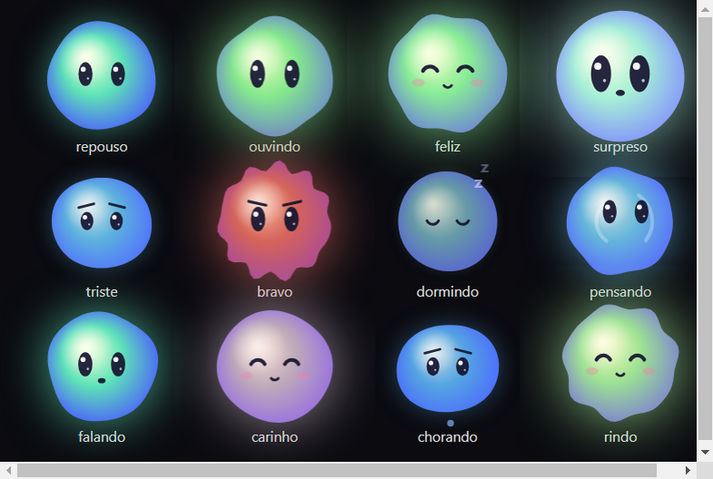

# Bip: assistente de voz para Windows

O Bip fica encostado na borda da tela como uma pílula pequena, com a data, a hora e um microfone verde mostrando que está ouvindo. Diga **"Bip"** (ou segure `ctrl + alt + b`) e peça o que quiser: ele escuta, responde e faz.

## Baixar

**[Baixar o instalador do Bip (Windows 10 e 11, 64 bits)](https://github.com/Idannyel/bip-download/releases/latest)**

Na página que abrir, clique em `Bip-Setup-....exe` para baixar.

## Instalar

1. Abra o arquivo baixado.
2. Se o Windows mostrar **"O Windows protegeu o computador"**, clique em **Mais informações** e depois em **Executar assim mesmo**. O aviso aparece porque o instalador não tem assinatura paga da Microsoft; não é vírus.
3. Siga o instalador (ele não pede administrador) e deixe marcado **Executar o Bip**.
4. Na primeira vez, o Bip pergunta seu nome e oferece instalar a **IA local** (Ollama). Aceite: ele baixa sozinho (alguns GB, uma vez só). Sem ela, o Bip ainda faz comandos diretos, como abrir programas, timers e música.

Depois disso, o Bip abre junto com o atalho **Bip** na área de trabalho e no Menu Iniciar.

## O que pedir

- "Abre o Cuphead na Steam", "bora jogar GTA 5"
- "Toca Don't Let Me Down dos Beatles no YouTube", "abre o canal do Felipe Neto"
- "Timer de 10 minutos para a pizza", "me acorda amanhã às 7"
- "Adiciona tarefa estudar inglês", "anota que preciso ligar pro dentista"
- "Cria uma pasta chamada Fotos da viagem na área de trabalho"
- "Como está o clima?", "quanto está o dólar?"
- "Tenho e-mail novo?" (depois de conectar o e-mail nos Ajustes)

## Requisitos

- Windows 10 ou 11, 64 bits
- Microfone
- Internet para a voz falada e para baixar a IA na primeira vez
- Para a IA local: 8 GB de memória ou mais (com menos, ele usa um modelo menor)

## Desinstalar

Configurações do Windows > Aplicativos > **Bip - assistente** > Desinstalar.
